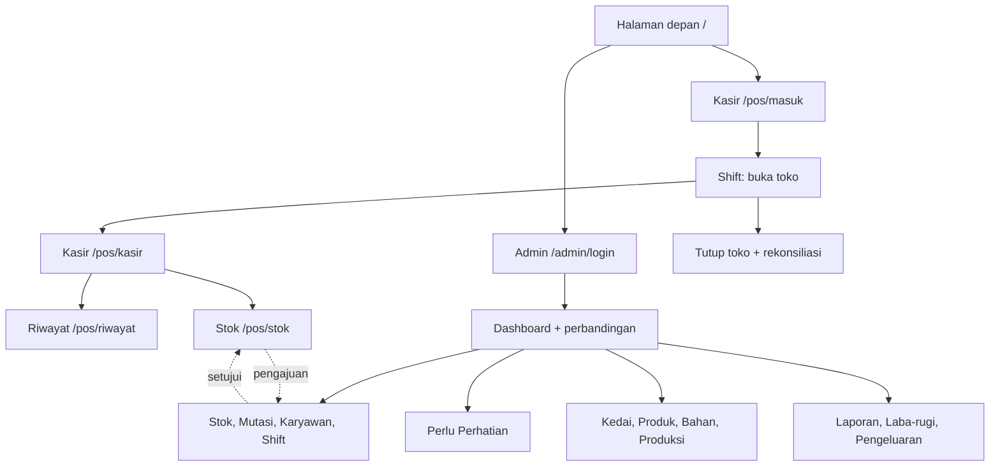

# Demo ke Klien — Panduan untuk Orang yang Memperagakan

Dokumen ini untuk orang yang **memperagakan sistem ini di depan calon klien**,
termasuk yang belum biasa memakai komputer. Bukan panduan developer — untuk itu
ada `docs/panduan/`.

Prinsipnya satu kalimat:

> Demo yang bagus bukan yang paling banyak fiturnya ditampilkan. Demo yang
> bagus membuat klien **melihat alur kerja mereka sendiri**, lalu keluar dari
> ruangan sudah yakin.

Tiga kesalahan yang paling sering terjadi:

1. Menjelaskan semua tombol dari awal sampai akhir. Klien bosan, dan tidak
   ingat satu pun.
2. Menjanjikan fitur yang belum ada. Janji yang tidak ditepati jauh lebih
   mahal daripada fitur yang belum ada.
3. Melewati bagian **offline**. Itu justru pembeda utama sistem ini, dan
   pertanyaan nomor satu yang selalu muncul.

---

## 1. Latihan dulu, baru tampil

Jangan mencoba pertama kali di depan klien. Jalankan sendiri satu kali penuh,
sampai bagian 12, tanpa dilihat siapa pun.

| Perangkat | Dipakai untuk |
|---|---|
| HP (Chrome Android) | Sisi kasir. Harus HP, karena kesan "dipakai kasir" muncul di layar sentuh kecil. |
| Laptop atau tablet | Sisi admin pusat. |

Kalau hanya punya satu perangkat: buka sisi admin di browser lain (misalnya
Chrome dan Edge) supaya dua sesi terpisah tidak saling menimpa.

---

## 2. Persiapan sebelum klien datang

| Yang disiapkan | Kenapa penting | Cara memastikan |
|---|---|---|
| Data contoh sudah ada | Layar kosong langsung menurunkan minat klien | Buka `/admin/produk` — harus ada 10 produk |
| PWA sudah terpasang di HP | Demo offline hanya jalan kalau aplikasi sudah terpasang | Chrome Android, menu, "Tambahkan ke layar utama" |
| Aplikasi sudah pernah dibuka | Antrean offline disimpan di penyimpanan browser HP, bukan di server | Buka `/pos/kasir` sekali sambil ada internet |
| Baterai HP penuh | Mode pesawat tetap memakai baterai | Cas penuh sebelum klien datang |
| Data lama sudah dibersihkan | Transaksi lama bikin klien bingung | Minta pengelola instance menjalankan `npm run seed` |

### Soal QRIS: tidak ditampilkan

Instance demo ini **tidak punya QRIS**. Di layar kasir hanya muncul tombol
**Tunai**, jadi tidak ada yang perlu disiapkan untuk pembayaran.

Kalau klien bertanya pembayaran nontunai, jawab jujur:

> "Untuk instance Anda sekarang, pencatatan di sistem cukup tunai dulu.
> Pembayaran nontunai tetap seperti biasa, hanya pencatatannya di luar sistem."

Jangan sebut Midtrans, dan jangan janjikan QRIS sebagai fitur yang bisa
diaktifkan besok. Klien belum membutuhkan, dan hal yang belum dibutuhkan cukup
dibicarakan nanti.

### Jangan lupa `--force`

`npm run seed` menolak jalan kalau tabel `transactions` sudah berisi data.
Pengelola instance perlu `npm run seed -- --force`. Kerjakan ini sebelum klien
datang, bukan di depan mereka.

---

## 3. Aturan emas

- Demo di perangkat milikmu, bukan di HP klien. Kalau klien mau mencoba
  sendiri, itu tahap "uji coba" — dengan data contoh, bukan data asli.
- Jangan pernah memakai HP pribadi untuk menyimpan data contoh yang sudah
  dipakai klien. Ini data demo, bukan data bisnis siapa pun.
- Jangan buka `/dev/ui`. Itu halaman internal developer.
- Jangan menjanjikan fitur yang belum ada (lihat bagian 9).
- Jangan menawar harga saat demo. Catat permintaannya, bawa ke pemilik.
- Jangan menyalin file repo atau memberi akses GitHub ke calon klien.
- Boleh diam sebentar. Membiarkan klien menyentuh HP-nya sendiri lebih meyakinkan
  daripada kamu menjelaskan terus.

---

## 4. Skenario demo

Ikuti urutan di bawah. Total sekitar 25 menit kalau tidak banyak tanya.

### Bagian 1 — Halaman depan (30 detik)

Buka `/`.

Kalimat pembuka:

> "Ini sistem kasir untuk kedai yang punya beberapa cabang. Saya tidak akan
> jelaskan semua tombol. Saya pakai saja seperti Contribute: buka toko, jualan
> beberapa pelanggan, tutup toko. Setelah itu Anda lihat sendiri hasilnya."

Sebutkan dua pintu yang ada di layar: **Kasir** dan **Admin Pusat**.

---

### Bagian 2 — Masuk sebagai admin (1 menit)

Buka `/admin/login`, lalu masuk dengan akun owner.

Kalimat:

> "Karyawan tidak punya password. Mereka cuma pindai kartu QR. Anda yang punya
> password, dan akun Anda hanya dipakai untuk melihat serta memutuskan."

Kalau yang hadir adalah calon pemilik, ini momen yang tepat untuk ditekankan:
akun mereka sendiri yang akan dipakai, bukan milik orang lain.

---

### Bagian 3 — Dashboard dan perbandingan cabang (3 menit)

Buka `/admin/dashboard`. Atur rentang tanggal ke kemarin, lalu tekan
Tampilkan.

Sebutkan tiga angka saja: omzet, jumlah transaksi, dan selisih kas.

Kemudian buka `/admin/dashboard/perbandingan`.

Kalimat:

> "Ini yang biasanya harus Anda mintip ke setiap cabang satu-satu. Sekarang
> semuanya sudah di satu halaman, dan Anda bisa lihat cabang mana yang
> tertinggal."

---

### Bagian 4 — Perlu Perhatian (1 menit)

Buka `/admin/perhatian`.

Kalimat:

> "Bagian ini adalah sistem yang nagih ke Anda, bukan Anda yang nagih ke
> kasir. Kas belum dibereskan, transaksi yang belum terkirim, pengajuan yang
> menunggu keputusan."

Seed sudah menyiapkan isi halaman ini, jadi layar tidak kosong. Lonceng di menu
menampilkan **4 notifikasi belum dibaca**:

| Yang tampil | Keterangan |
|---|---|
| Pembatalan menunggu | Pengajuan void di Kenanga yang belum diputuskan |
| Stok menipis | Pisang Goreng Melati dan Kentang Goreng Kenanga tinggal sedikit |
| Ada selisih kas | Sesi Melati kemarin ditutup dengan selisih `-15.000`, statusnya masih **Terbuka** |
| Antrian belum terkirim | Sesi Melati 4 hari lalu ditutup dengan 3 transaksi yang belum masuk |

Dua bagian lain di halaman ini juga terisi: **Kas belum dibereskan** memuat
satu sesi Melati (tombol **Buka Setoran** di situ), dan **Antrian belum
terkirim** memuat sesi Melati 4 hari itu. Selisih Melati 3 hari lalu sengaja
sudah berstatus **Sudah dijelaskan** supaya kelihatan bedanya: yang itu tidak
masuk daftar.

Kalau muncul item lain, itu kejadian nyata dari pemakaian, bukan data contoh.

---

### Bagian 5 — Data master, ditampilkan singkat (2 menit)

Klik berurutan saja, jangan dijelaskan mendetail:

| Halaman | Yang ditunjukkan |
|---|---|
| `/admin/kedai` | Dua kedai dan satu gudang pusat |
| `/admin/produk` | Sepuluh produk; katalog dipakai bersama, stok per kedai |
| `/admin/bahan` | Bahan baku untuk produksi |
| `/admin/produksi` | Produksi mengubah bahan jadi stok siap jual |

Tunjuk satu barang saja, lalu pindah halaman. Jangan dibaca semua nama produk.

---

### Bagian 6 — Pindah ke HP, sisi kasir (3 menit)

Sekarang ambil HP. Buka `/pos/masuk`.

Di halaman itu ada pemindai QR, dan di bawahnya kolom **ketik manual**. Untuk
demo, ketik saja kode kartu karyawan:

```
DEV-QR-RINA-0001
```

Sesi akan terbuka sebagai Rina Kasir di Kedai Melati.

Kalimat:

> "Kartu ini melekat pada orang, bukan pada HP. Kalau HP-nya hilang, kartu ini
> masih bisa dipakai di HP lain. Kalau kartunya hilang, Anda yang mencetaknya
> lagi."

Lanjut ke menu **Shift**, isi **Kas awal** (misal 500.000), tekan **Buka
Toko**. Kasir sekarang bisa menerima penjualan.

---

### Bagian 7 — Satu transaksi biasa (3 menit)

Buka `/pos/kasir`.

1. Ketuk **Kopi Susu Gula Aren** (22.000).
2. Ketuk **Roti Bakar Cokelat** (18.000).
3. Tekan **Lihat Keranjang**, cek totalnya.
4. Pilih **Tunai**, tekan **Bayar**.

Buka `/pos/riwayat`. Transaksi itu ada di sana.

Kalimat:

> "Stok barang itu berkurang sendiri, dan perubahannya tercatat siapa, kapan,
> dan kenapa. Tidak ada angka stok yang berubah tanpa jejak."

Kalau sempat, tunjukkan menu **Stok** di HP: barang **Pisang Goreng** sengaja
dibuat menipis supaya klien bisa lihat indikatornya.

---

### Bagian 8 — Internet mati (3 menit, bagian terpenting)

INI BAGIAN YANG TIDAK BOLEH DILEWATI.

1. Di HP, aktifkan **mode pesawat**.
2. Kembali ke `/pos/kasir`. Buat **dua transaksi** seperti tadi, tetap tunai.
3. Buka `/pos/riwayat`. Dua transaksi itu ada, tapi berlabel **Belum sync**.
4. Matikan mode pesawat.
5. Tunggu beberapa detik, lalu buka `/pos/riwayat` lagi. Label **Belum sync**
   hilang, dan di dashboard owner angka omzet bertambah.

Kalimat:

> "Ini yang paling sering jadi pertanyaan. Di kedai, Wi-Fi sering mati. Kasir
> tetap jualan, transaksinya tersimpan di HP, dan dikirim sendiri begitu ada
> internet."

Kalau ada bilah kuning "N transaksi gagal terkirim", tekan **Coba lagi**
dulu sebelum lanjut.

Batasnya, jujur saja kepada klien:

- Yang bisa dilakukan offline: jualan **tunai**, buka/tutup toko, catat
  waste, hitung stok fisik.
- Yang butuh online: persetujuan pindah stok dan laporan pusat.

---

### Bagian 9 — Tutup toko dan selisih kas (2 menit)

Di HP, buka menu **Shift**.

1. **Hitung Fisik Sisa Stok** — isi sesuai yang benar-benar ada di rak, lalu
   **Simpan Hitungan**.
2. **Tutup Toko** — masukkan uang yang benar-benar ada di laci. Untuk demo,
   kurangi sedikit (misal 20.000) supaya selisihnya terlihat.
3. Baca hasil: berapa yang seharusnya ada, dan berapa selisihnya.

Kalimat:

> "Selisih kas tidak bisa disembunyikan. Uang di laci dibandingkan dengan
> yang tercatat, dan selisihnya ditulis. Besok pagi Anda tahu kalau ada yang
> janggal."

Kalau muncul "Belum final", berarti masih ada transaksi yang belum terkirim.
Biarkan HP online beberapa saat sampai habis.

---

### Bagian 10 — Pindah stok antar kedai (3 menit)

Di HP, buka menu **Stok**, tekan **Pindah Stok** pada satu barang, pilih
Kedai Kenanga sebagai tujuan, isi jumlah, lalu **Ajukan**.

Sekarang pindah ke laptop, buka `/admin/mutasi`. Pengajuan itu statusnya
**Menunggu**. Setujui.

Catatan: `/admin/mutasi` sudah punya satu pengajuan lama dari seed yang juga
**Menunggu** (3 Matcha dari Melati ke Kenanga). Bedakan dari isi kolom alasan —
setujui yang baru saja kamu buat.

Kemudian buka `/admin/stok`: stok di Melati berkurang, stok di Kenanga
bertambah.

Kalimat:

> "Barang tidak bisa pindah antar cabang diam-diam. Selalu ada pengajuan,
> dan selalu ada yang menyetujui. Kalau tidak, hilang stok tidak ketahuan
> dari mana."

---

### Bagian 11 — Laporan dan untung-rugi (2 menit)

| Halaman | Yang ditunjukkan |
|---|---|
| `/admin/laporan` | Omzet per kedai |
| `/admin/laporan/laba-rugi` | Omzet dikurangi pengeluaran |
| `/admin/pengeluaran` | Catat pengeluaran: bahan baku, listrik, sewa, gaji |

Kalimat:

> "Omzet itu belum tentu laba. Di sini omzet dikurangi pengeluaran, jadi
> kelihatan benar-benar untung atau rugi. Biaya juga bisa dibandingkan antar
> kedai."

Jangan menambahkan cara hitung manual di depan klien. Kalau ada dua angka
omzet yang berbeda di ruangan yang sama, kepercayaan langsung hilang.

---

### Bagian 12 — Penutup (1 menit)

Kalimat penutup:

> "Yang tadi kita pakai adalah alur hariannya, dari buka sampai tutup. Kalau
> sistem ini dipakai, Anda tidak perlu minta laporan ke setiap kedai.
> Semuanya sudah terkumpul."

Jangan langsung menyebut harga di bagian ini. Tutup dengan ajakan tahap
berikutnya, bukan dengan angka.

---

## 5. Pertanyaan yang sering muncul

Jawab jujur. Kalau tidak tahu, bilang tidak tahu lalu catat.

| Pertanyaan | Jawaban |
|---|---|
| "Kalau internet mati?" | Kasir tetap bisa jualan tunai. Transaksi masuk antrian di HP dan dikirim otomatis begitu online. Yang tidak bisa: persetujuan pindah stok dan laporan pusat. |
| "Kalau HP kasir hilang?" | Sesi kasir melekat pada kartu QR, bukan pada HP. Kartu bisa dipakai di HP lain. Data transaksi ada di server, bukan cuma di HP. |
| "Bisa cetak struk?" | Belum. Ini salah satu yang masuk daftar berikutnya. |
| "Pajak dan PPN?" | Belum dihitung otomatis. |
| "Bisa pesan sendiri lewat QR meja?" | Belum. Sekarang semua order diinput kasir. |
| "Stok bisa dinyalin sendiri antar cabang?" | Tidak bisa. Harus ada pengajuan dan persetujuan. Ini disengaja. |
| "Salah input transaksi, bisa dihapus?" | Tidak dihapus. Transaksi ditandai void dengan alasan, stok dikembalikan, dan riwayatnya tetap ada. |
| "Data saya aman?" | Server milik klien sendiri, terpisah dari klien lain. Orang hanya bisa masuk ke bagiannya. |
| "Berapa lama implementasinya?" | Bawa ke pemilik sistem, jangan dijawab sendiri. |
| "Harganya berapa?" | Jangan jawab di tempat. Catat, lalu bawa ke pemilik. |

---

## 6. Batas sistem yang perlu diketahui

Hal-hal ini **belum ada**. Kalau klien menanyakannya, jawab apa adanya, jangan
dijanjikan tanggal.

| Belum ada | Catatan |
|---|---|
| Cetak struk fisik | Tidak ada integrasi printer thermal |
| Pajak atau PPN otomatis | Omzet yang ditampilkan belum dipotong pajak |
| Varian produk dan resep bahan | Satu produk satu harga, tidak ada ukuran atau topping |
| Notifikasi WhatsApp atau push | Peringatan hanya muncul di dalam aplikasi |
| Mode gelap | Hanya tema terang |
| Pembayaran nontunai di dalam sistem | Instance ini hanya mencatat pembayaran tunai |

Batas offline juga perlu disebut: yang tetap jalan hanya pencatatan kasir
tunai. Persetujuan pindah stok dan laporan pusat menunggu koneksi.

---

## 7. Setelah demo

- [ ] Catat semua pertanyaan yang muncul, bawa ke pemilik sistem.
- [ ] Minta pengelola instance mengembalikan data demo: `npm run seed -- --force`.
- [ ] Kirim manual book (`docs/manual/`), bukan repo.
- [ ] Tawarkan tahap berikutnya: uji coba satu kedai, satu minggu, dengan data
      contoh lebih dulu.
- [ ] Jangan kirim kredensial lewat WhatsApp.

---

## Lampiran A — Peta layar

Dua pintu, dipisah sengaja. Karyawan tidak bisa masuk ke sisi admin, dan
sebaliknya.



## Lampiran B — Akun demo

Akun di bawah ini hanya untuk instance pengembangan. Jangan dipakai di
instance klien.

| Peran | Masuk lewat | Akun |
|---|---|---|
| Owner | `/admin/login` | `owner@kedaidev.test` / `dev-owner-2026` |
| Admin pusat | `/admin/login` | `admin@kedaidev.test` / `dev-admin-2026` |
| Kasir Kedai Melati | `/pos/masuk` (ketik kode kartu) | `DEV-QR-RINA-0001` |
| Kepala Kedai Melati | `/pos/masuk` | `DEV-QR-BUDI-0002` |
| Kasir Kedai Kenanga | `/pos/masuk` | `DEV-QR-SARI-0003` |

Data contoh yang ada di seed: dua kedai (Melati, Kenanga) plus Gudang Pusat,
sepuluh produk, tiga karyawan, bahan baku, produksi, pengeluaran, dan riwayat
transaksi tunai 14 hari supaya grafik dashboard langsung berisi. Melati
sengaja belum punya shift terbuka hari ini, jadi sesi "Buka Toko" masih bisa
didemokan.


